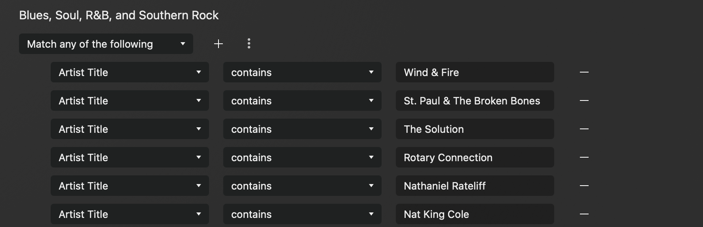

# Plexamp helper app

## MVP Features
- Deployed as docker containers using compose.yaml
    - db
    - db-init
    - frontend
    - worker
    - (optional) traefik instance
- Desktop and mobile version
- Sign in with Plex account and connect the plex server to the app
- The app should thus not be linked to one specific plex server, but it should be based on the user logging in and the server they choose
- Connect last.fm account
    - Populate Plex database with scrobbles from last.fm
        - I've used Plexamp for a year or two, so Plex only has stats since then. The goal of this is to populate/update the stats based on the users data from last.fm.
- Rating feature
    - Rate songs, artists, or albums
        - Three modes for each of songs/artists/albums:
            - Only songs/albums/artists the user has listened to
            - All unrated songs/albums/artists
            - Everything, including already rated songs/albums/artists (already rated things should be clearly labelled and skippable)
        - The 'songs listened to' mode should surface songs/artists/albums to rate in three different ways:
            - At random, but slightly weighed towards songs/artists/albums the user has listened to more so the user doesn't get 10 basically unknown songs in a row - the user needs to be kept interested by being given songs to rate they actually know
            - most listened to songs first
            - most popular songs/albums/artists first - based on the popularity field in plex.
            - The latter two modes still need a bit of randomness built in to it so that it doesn't list the most popular songs of the most popular artist first, which could result in for example 50 Beatles or Radiohead songs in a row. While it should adhere to showing the most popular songs first, it should randomise the artists, but slightly weigh it towards the most popular artists.
        - Songs and albums should use the album cover as image and artists should use the artist image from plex
        - the mobile version should show one song/album/artist at a time, and use a swipe action to rate. Swipe left to rate 2 or less, swipe right to rate 2.5 or higher. The longer the swipe the lower/higher the rating. Swipe down to skip to the next song.
        - it should be possible to view the desktop version on mobile as well by clicking on a toggle
        - the desktop version should use a different way to rate, and it should be different based on whether the user wants to rate songs, albums, or artists. It should still be very easy and intuitive to rate the songs/albums/artists. 
            - For songs the app should show (for example) ten songs at a time, but it should be based on the users viewport. Scrolling shouldn't be possible. 
            - The album rating mode should show the album cover, name, artist, all the songs (and it should be possible to rate each song individually), as well as the album review. Rating the album can be done by hovering over the album cover which should display the 5 stars, and based on where the user clicks a rating is set. Click all the way on the left hand side of the cover for a rating of 1, all the way to the right for a rating of 5.
            - The artist rating mode should show the artist image from plex, and the artists most popular albums (the user should be able to rate each album here as well). It should also show the five most popular songs of that artist, and the artist biography. 
- Set artist image just like /Users/joakim/github/personal/docker/plex-artist-logos
    - The plex-artist-logos app works, but it's quite rudimentary, and needs a bit of finetuning and bug fixing. The main points that it should be able to do are listed below:
        - Connection to fanart.tv
        - Ability to upload a custom image
        - Ability to create a custom artist image with a custom font.
        - The plex-artist-logos app can't do this yet, but I'd like this plex helper app to search google images for '<artist name> logo' and select one of the resulsts as the artists image in plex
        - Ability to save the artist image to the artists folder
        - Export/Import feature:
            - export and download all artists images
            - Ability to import such an export
                - Plex sets a picture of the artist as the artist image by default, but lots of people prefer to use the artists logo instead. The goal of this feature is therefore to be able to easily share loads of artist logos in one go.
- Option to sync all metadata from plex into this apps database.
    - The point of this feature is basically to have a backup of the metadata, in case plex/plexamp would cease to exist or something similar. It should be possible to export it in a way that the data can be imported into other music apps/players. 
- I'd like to be able to create smart playlists in an easier way than how it's done in Plex/plexamp currently. The way I use such playlists is that I play them on shuffle with DJ Stretch enabled. Such playlists currently consists of a bunch of 'artist title contains = xxx' filters which works okay (), but it's very cumbersome to create, not very smart, and every song by an artist added to the playlist are added to the playlist. I'm forced to use this since the genre and mood radios in plex doesn't work very well, presumably since it's based on data from musicbrainz and the people who tag music with genres or moods have VERY different ideas of what a genre or a mood is. 
I'd therefore like to have a feature that can create (static) playlists with these options:
    - The user either picks an artist or song directly, or picks a genre or mood. 
        - If the user picks an artist or song it should offer to add similar artists/songs to the playlist (similar to how the 'add similar songs' works in spotify). It should use the similar artists and the sonically similar artists/songs in plex for this.
        - If the user chooses a genre or mood, it should show the top ten artists of that genre or mood and then let the user select one (or multiple) of them, and from then on work the same as when the user picks an artist or song directly
            - The user should be able to only include songs rated higher/lower than X, with or without unrated songs
            - The user should also be able to only include the top XX% of each artists songs (based on the song popularity field)
            - these two options should support AND/OR
    - Since the app creates static playlists it should be possible to update the playlists either manually, or automatically every day/week/month/etc

## Later features
- Whilst I don't want the app to be a fully fledged plex music client, I'd like to be able to preview/play songs directly in the app (limited to the first 30-60 secs of a song). This could be very useful when creating playlists.
    - When a song is played through this app it shouldn't count towards the users stats in plex
- 